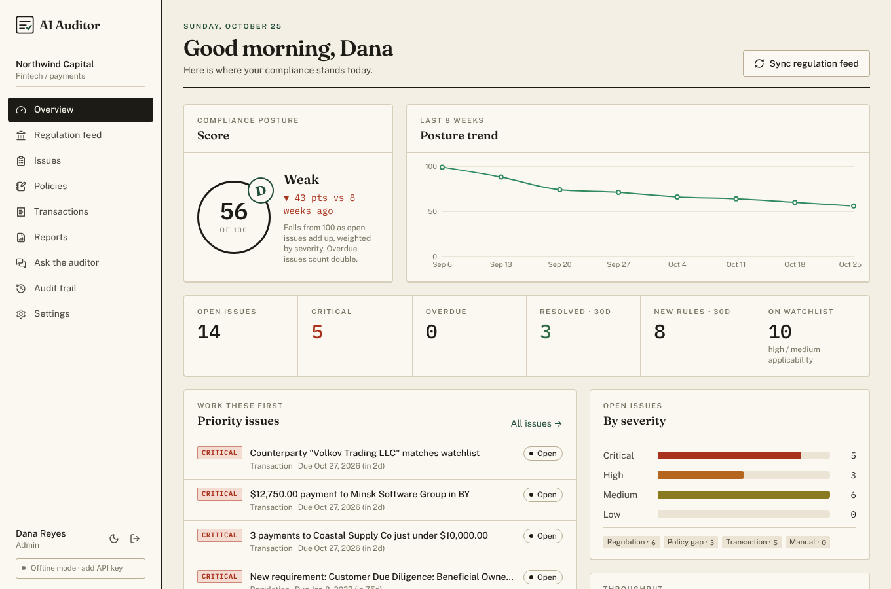

# AI Auditor

**AI-native compliance infrastructure for finance teams.** AI Auditor watches regulators every day, works out which changes apply to *your* company, and flags the issues hiding in your policies and payments before an examiner or auditor finds them.

> The regulations changed this morning. You already know what to do.



---

## Why this exists

Finance and compliance teams at fintechs, lenders, broker-dealers and public companies are expected to track thousands of pages of new rules, proposals, guidance and enforcement actions each year, across many regulators. Today that work is done by hand: someone skims the Federal Register, forwards a PDF, a spreadsheet of "obligations" goes stale, and the gap is found in the next audit.

Language models can now read regulation as well as a junior analyst, at the speed of a feed. That makes a new kind of product possible: **compliance infrastructure that is AI-native from the start**, not a document repository with a chatbot bolted on. This is one of the startup ideas Y Combinator has highlighted for AI: software that does the work of a compliance function rather than helping a human do it slightly faster.

AI Auditor is a working implementation of that idea.

## What it does

| Step | What happens |
| --- | --- |
| **Watch** | Pulls new documents from the US Federal Register (SEC, CFPB, FinCEN, OCC, Fed, FDIC, IRS, CFTC, OFAC) and regulator RSS feeds (SEC press and litigation releases, UK FCA). Runs on demand or on a daily cron. |
| **Interpret** | Claude reads each document against your company profile (jurisdictions, entity types, activities, size), scores applicability and impact 0-100, and extracts concrete obligations with control areas and deadlines. |
| **Flag** | High-impact rules automatically open issues. Policy gap checks compare your written policies with every obligation in their control area. Transaction monitoring runs explainable rules over ledger uploads. |
| **Prove** | Every analysis, decision and change goes into an append-only audit trail. Board-ready reports, with an executive summary written by Claude, are one click away. |

### Features

- **Dashboard** with a compliance posture score (A-E), 8-week trend, raised-vs-resolved throughput, priority issues, deadline calendar and a regulatory watchlist.
- **Regulation feed** with search, filters, impact meters and one-click analysis. Each document page shows the plain-English summary, why it applies, obligations, next steps and linked issues.
- **Issues** workflow: severity, owner, due date, status (open, in progress, remediated, accepted risk with a required justification), discussion, full change history, and CSV export (with spreadsheet-formula injection protection).
- **Policies** library with AI gap checks against extracted obligations.
- **Transaction monitoring**: upload an AP/GL/bank CSV (flexible column names). Rules catch sanctioned jurisdictions, watchlist matches, structuring under the $10k threshold, maker-checker breaks, large unapproved payments, duplicate payments, round amounts and weekend postings. Re-uploads don't duplicate open findings.
- **Reports**: frozen point-in-time compliance packs with print / save-as-PDF styling.
- **Ask the auditor**: a streaming assistant grounded in your own obligations and open issues.
- **Teams and roles**: admin, analyst, viewer; enforced on every API route.
- **Light and dark themes**, responsive down to phone width.

## How the AI is used

All model calls live in [`src/lib/ai`](src/lib/ai) and use the official Anthropic TypeScript SDK.

- **Model:** `claude-opus-5-5` by default (override with `ANTHROPIC_MODEL`).
- **Structured outputs:** analysis, gap checks and report narratives use `output_config.format` with Zod schemas, so responses are validated JSON, never scraped text.
- **Adaptive thinking + effort:** `high` effort for regulatory analysis and gap checks, `medium` for report narratives and chat.
- **Streaming** for every call, so long analyses never hit HTTP timeouts; the assistant streams tokens to the browser.
- **Refusal fallbacks:** requests opt into server-side fallbacks (`fallbacks: "default"`), and a `refusal` stop reason is handled explicitly.
- **Prompt caching** on the assistant's system prompt and workspace snapshot.
- **Deterministic where it matters:** transaction monitoring is rule-based on purpose, so every flag is explainable and reproducible for auditors.
- **Offline mode:** with no API key, every feature falls back to a transparent keyword engine ([`heuristics.ts`](src/lib/ai/heuristics.ts)) and says so in the UI. The app is fully usable for demos and tests without credentials.

## Tech stack

| Layer | Choice |
| --- | --- |
| App | Next.js 16 (App Router, Cache Components), React 19, TypeScript |
| Styling | Tailwind CSS 4 with a custom "audit ledger" design system (Fraunces, Public Sans, IBM Plex Mono) |
| Data | Drizzle ORM on libSQL: a SQLite file locally, Turso in production |
| Auth | Email + password (bcrypt), signed JWT session cookie (jose), role checks per route, login rate limiting |
| AI | Anthropic SDK, Claude Opus 5.5 |
| Feeds | Federal Register API, RSS/Atom via fast-xml-parser |
| Charts | Recharts |
| Tests | Vitest unit tests (rules, parsers, scoring, offline engine, Claude request shape) |

## Quick start

Requires Node.js 22+.

```bash
git clone https://github.com/samar403/ai-auditor.git
cd ai-auditor
npm install
cp .env.example .env.local      # add ANTHROPIC_API_KEY for full AI features
npm run dev                     # migrates, seeds a demo workspace, starts on :3000
```

Open http://localhost:3000 and sign in with **demo@aiauditor.dev / demo1234** (also `analyst@` and `viewer@` with the same password to see role limits).

The demo workspace ("Northwind Capital", a US/EU payments company) comes with 12 sample regulations, 3 policies, a seeded ledger with planted control failures, and issue history. Sample regulations are labelled *Sample* in the feed; press **Sync now** to pull live documents.

### Scripts

| Command | What it does |
| --- | --- |
| `npm run dev` | Setup + dev server |
| `npm run setup` | Apply migrations and seed the demo workspace if the database is empty (`SEED_DEMO=false` to skip) |
| `npm run build` / `npm start` | Production build and server |
| `npm test` | Unit tests |
| `npm run lint` / `npm run typecheck` | Static checks |
| `npm run db:generate` | Create a migration after editing `src/lib/db/schema.ts` |

## Configuration

See [`.env.example`](.env.example).

| Variable | Purpose |
| --- | --- |
| `AUTH_SECRET` | **Required in production.** Signs session cookies. `openssl rand -base64 32` |
| `ANTHROPIC_API_KEY` | Enables Claude. Without it the app runs in offline mode. |
| `ANTHROPIC_MODEL` | Optional model override. |
| `DATABASE_URL` / `DATABASE_AUTH_TOKEN` | `file:./data/ai-auditor.db` locally, or a Turso `libsql://` URL and token. |
| `CRON_SECRET` | Protects `GET /api/cron/sync`. |
| `FEED_USER_AGENT` | Contact string for regulator feeds (the SEC asks automated clients to identify themselves). |

## Deploying

**Vercel + Turso** (recommended): create a Turso database, set the env vars above, run `npm run setup` once against it with `SEED_DEMO=false`, and deploy. [`vercel.json`](vercel.json) schedules the daily feed sync at 06:00 UTC; Vercel sends `CRON_SECRET` automatically.

**Any Node host:** `npm run setup && npm run build && npm start`, with a persistent disk for the SQLite file or a Turso URL. Call `/api/cron/sync` from your scheduler with `Authorization: Bearer $CRON_SECRET`.

## Project layout

```
src/
  app/
    page.tsx                 landing page
    login/ signup/           auth pages
    app/                     the product (dashboard, regulations, issues, policies,
                             transactions, reports, assistant, audit-log, settings)
    api/                     REST endpoints, all wrapped in withAuth()
  components/                UI kit (ui.tsx), app shell, charts, markdown
  lib/
    ai/                      Claude client, regulation analysis, gap checks, assistant, offline engine
    feeds/                   Federal Register + RSS connectors and sync
    monitoring/              ledger CSV parsing and transaction rules
    services/                analysis, policy and ledger workflows (issue creation + audit trail)
    db/                      Drizzle schema and client
    reports.ts scoring.ts auth.ts audit.ts
drizzle/                     SQL migrations
scripts/                     setup + seed, sample ledger generator
tests/                       Vitest suites
docs/PRODUCT_PROMPT.md       the product brief this was built from
```

## Security notes

- Every API route re-checks the session against the database and enforces a minimum role; `proxy.ts` only does an optimistic redirect.
- Every query is scoped by `orgId`, so workspaces are isolated.
- The audit log is append-only from the application's point of view.
- Assistant output is rendered with a small Markdown renderer that builds React elements; no model HTML is injected.
- The demo sanctions watchlist is illustrative. Connect a real screening provider before relying on it.

## Roadmap

- SSO (SAML/OIDC) and email invites
- More sources: state regulators, EU (ESMA/EBA), RBI and SEBI, MAS
- Direct ERP and bank integrations (NetSuite, QuickBooks, Ramp) instead of CSV
- Evidence uploads on issues, and control testing schedules
- Slack and email alerts for new high-impact rules

---

AI Auditor provides decision support, not legal advice. Have qualified compliance staff review its findings.
